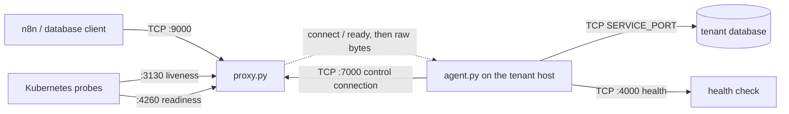
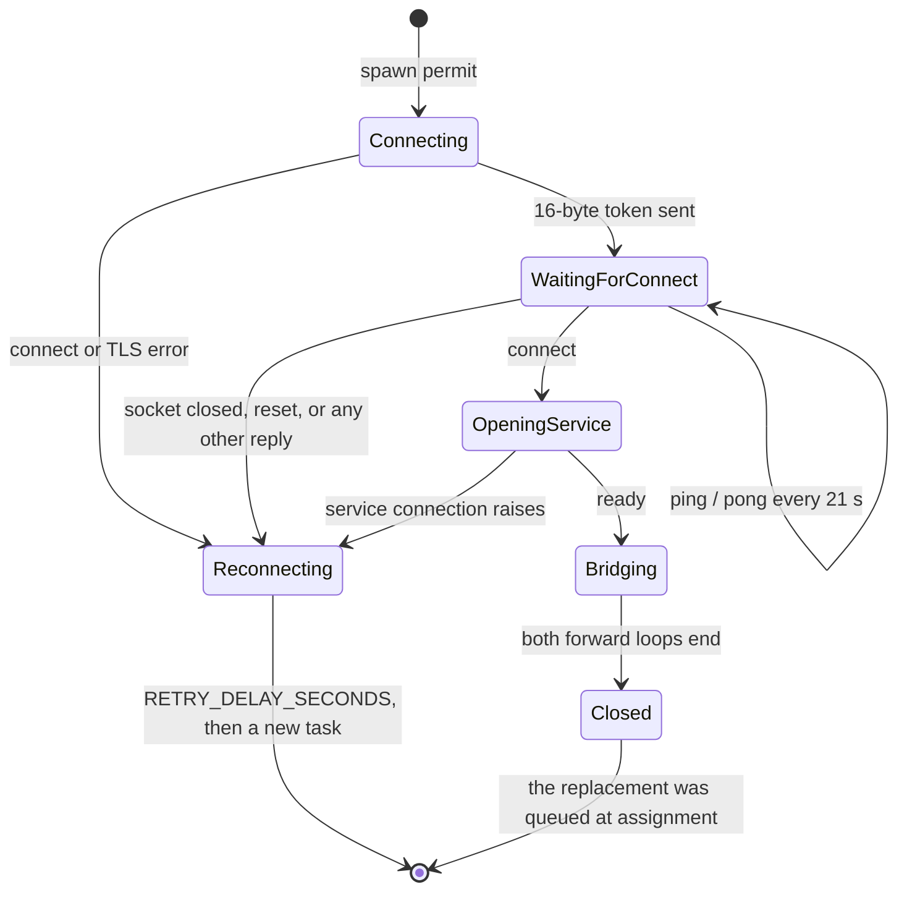

# Architecture

DBridge carries database traffic between clients that cannot route to a tenant host and the
database service that host runs. Two standalone asyncio processes do the work: `proxy.py`, which
clients reach and which holds a pool of agent connections, and `agent.py`, which runs on the
tenant host and dials out to the proxy. Neither process parses the database protocol; bytes are
forwarded unchanged. Decisions and their rationale are not recorded as ADRs in this repository
yet — see [ADR index](#adr-index).

## Context

`proxy.py` listens on four ports: agents (`:7000`), clients (`:9000`), liveness (`:3130`) and
readiness (`:4260`). `agent.py` holds one control connection per concurrency slot, answers the
proxy's keepalive, and opens a local service connection when it is assigned a client. The pool is
memory-only: a new proxy process starts empty and waits for agents to register.

Non-goals: authenticating agents, parsing or rewriting SQL, persisting state, any user interface.

## Modules

| Module | Responsibility | Location | Depends on |
|---|---|---|---|
| Proxy process | Four listeners, agent registration, keepalive, pool, assignment, byte forwarding, optional TLS | `proxy.py` | Python stdlib only |
| Agent process | Outbound control connections, keepalive replies, service dial, byte forwarding, local health port | `agent.py` | Python stdlib only, the tenant service |
| Pool regression tests | `AgentPoolLifecycleTest`: assignment, reset during keepalive, empty pool | `test_proxy.py` | `proxy.py` |
| Proxy image | `python:3.14-alpine`, one file, four exposed ports | `Dockerfile.proxy` | — |
| Agent image | `python:3.14-alpine`, one file, health port | `Dockerfile.agent` | — |
| Agent executable | PyInstaller one-file console build `agent.exe`, attached to a tag's GitHub Release | `.github/workflows/build-pyinstaller-agent.yml`; `dbridge_agent.spec` is the local equivalent, not used by CI | — |
| Local fixtures | Four database containers for manual testing; DBridge itself is not in the compose file | `docker-compose.yml` | — |

The two scripts are standalone: `format_peer`, `writer_peer`, `parse`, `parse_bool` and `forward`
exist in both files with the same shape, and there is no shared package. `agent.py` never imports
`proxy.py` or the reverse.

## Runtime model

- One asyncio event loop per process; one task per accepted or opened connection. There are no
  threads despite the `MIN_THREADS` / `--min-threads` name — it sizes a queue of agent tasks.
- The pool is `proxy.Context`, a module-level singleton: `agents: list[Agent]` plus an
  `asyncio.Lock`. `Context.length()` reads it, `add_agent()` appends, `pop_agent()` takes from the
  front (FIFO) and `clean_zombies()` sweeps it.
- Each `Agent` owns its token (`uuid.UUID`), the stream pair, `ping_pong_interval` and at most one
  keepalive task. `pop_agent()` stops that task before handing the connection to a client.
- The agent's concurrency is an `asyncio.Queue` of spawn permits consumed by `spawn_agents`. `main()`
  seeds `MIN_THREADS` permits; each permit creates one `run_agent` task, which is one control
  connection.
- An agent connection serves at most one bridge. When the proxy sends `connect`, the agent queues
  a replacement connection before it opens the service, so a bridge does not reduce the idle count.

## Wire protocol

All messages are unframed byte strings on the control connection.

| Step | Direction | Bytes | Meaning |
|---|---|---|---|
| Token | agent → proxy | 16 | `uuid.UUID.bytes`, written raw; the proxy reads 16 bytes and labels the connection `agent=<uuid>` |
| `ping` | proxy → agent | `ping` (4) | Keepalive, every `PING_PONG_INTERVAL_SECONDS` |
| `pong` | agent → proxy | `pong` (4) | Expected within a hard-coded 5 s |
| `connect` | proxy → agent | `connect` (7) | Assignment: promote this connection to a bridge |
| `ready` | agent → proxy | `ready` (5) | The agent has connected to the local service |
| data | both | raw | Forwarded unchanged, 4096 bytes per read on each side |

Notes that matter when changing either side:

- The proxy reads the token with `reader.read(16)`, not `readexactly`; the agent reads the next
  message with `proxy_reader.read(7)` — enough for `connect` — and compares the result to `b"ping"`
  and `b"connect"`. Short reads are not framed or retried.
- The token is an identifier, not a credential: the proxy accepts any 16 bytes that parse as a
  UUID. The `ALLOWED_AGENTS` / `ALLOWED_CLIENTS` peer-IP allowlists (default `*`) are the only
  admission check.
- `ping`/`pong` exists only while the connection sits in the pool. `pop_agent()` stops it, so the
  bridge phase has no keepalive at the application level.
- The keepalive is driven by the proxy only; the agent never initiates one.

## Data flows

1. **Registration.** The agent opens TCP to `PROXY_HOST:PROXY_PORT` (TLS when `USE_SSL` is set,
   verified against `SSL_CERT` if given), logs `state=connected`, then writes its 16-byte token.
   The proxy's `handle_agent` checks the peer IP against `ALLOWED_AGENTS`, `Context.add_agent`
   reads the token, creates the `Agent`, starts the keepalive task and appends it to the pool
   (`state=registered`, `pool_size` at DEBUG).
2. **Keepalive.** Per agent, the proxy writes `ping`, waits at most 5 s for `pong`, then sleeps
   `PING_PONG_INTERVAL_SECONDS` (21 s by default) and repeats. A mismatch, timeout or socket error
   logs `ping_loop_failed closing_connection` and closes the connection.
3. **Client connect and assignment.** The client arrives on `:9000`, the peer IP is checked against
   `ALLOWED_CLIENTS`, and `handle_client` tries `Context.pop_agent()` up to
   `WAIT_AGENT_MAX_TRIES` times with `WAIT_AGENT_RETRY_INTERVAL` between attempts (10 × 0.7 s,
   ≈ 7 s). `pop_agent` skips entries whose reader is at EOF or whose writer is closing. When the
   pool stays empty the client is closed and `no_agent_available` is logged; nothing is sent to it.
4. **Handshake.** The proxy writes `connect` on the assigned connection and waits for `ready`
   (see the timeout table for the current absence of a deadline). Only then does it start the
   bridge; a wrong reply closes both sides with `bridge_aborted reason=agent_not_ready` and the
   connection is not returned to the pool.
5. **Bridge.** `handle_client` gathers two `proxy.forward()` loops — `client->agent` (client reader
   to agent writer) and `agent->client` (agent reader to client writer) — with the proxy's
   `FORWARD_IDLE_TIMEOUT_SECONDS`. The agent, after sending `ready`, gathers `proxy->service`
   (proxy reader to service writer) and `service->proxy` (service reader to proxy writer) with its
   own `FORWARD_IDLE_TIMEOUT_SECONDS`. Each loop reads up to 4096 bytes, writes and drains; when one
   direction ends it closes its destination, which ends the other. Both sides log start, duration
   and per-direction byte counts.
6. **Refill and reconnect.** Before the agent sends `ready` it puts one permit on the spawn queue,
   so `spawn_agents` starts a replacement connection with a fresh token. If `run_agent` fails
   before that point — connect error, TLS error, handshake failure — it sleeps
   `RETRY_DELAY_SECONDS` and, in `finally`, puts a permit back only when it has not already done so.
   The new task always connects with a new UUID. The handshake-failure branch queues its own permit
   before returning and `finally` queues a second one (`new_agent_spawned` is still false), so one
   failed handshake starts two replacement connections.

## Connection lifecycle and reconnection

The agent has no application-level deadline on the control read, so a connection that is silently
half-open (the peer is gone, no FIN and no RST reaches the host) stays in `WaitingForConnect`
until the socket itself reports EOF, reset or a TCP timeout. Detection of a replaced proxy
therefore depends on the tenant host receiving an error; when it does, the path above reconnects
after `RETRY_DELAY_SECONDS` with no human action.

## Failure behaviour

- **No agent available.** The client waits ≈ 7 s and is closed without a reply. The proxy logs
  `no_agent_available`; the client sees the connection end.
- **Agent never sends `ready`.** The proxy blocks on `agent.reader.read(5)` with no deadline and
  holds both the client and the assigned connection. The slot is not returned to the pool, and
  neither side is closed until the socket dies or the agent replies.
- **Service connection fails.** The agent's `open_connection` result is unpacked although
  `return_exceptions=True` can put an exception there, so the failure surfaces as a `TypeError`
  from tuple unpacking, logged as `connection_error` and retried. The control connection is closed
  without `ready`.
- **Keepalive fails.** The proxy closes the socket. The agent's blocked read returns or raises; its
  next step is the handshake-failure branch, which closes, backs off and spawns a replacement.
- **Proxy restarts.** Every control connection ends at once; agents take the reconnect path. The
  new proxy starts with an empty pool and fills it only through registrations — there is no
  handover of tokens or sessions.
- **Client disconnects mid-bridge.** The client→agent loop sees EOF, closes the agent writer, and
  the agent's forwarding ends. The agent-side replacement connection was already queued.

## Timeouts

| Timer | Setting | Current value | Where |
|---|---|---|---|
| Keepalive interval | `PING_PONG_INTERVAL_SECONDS` | 21 s, validated `0 < x < 30` | `Agent.run_ping_pong` |
| Pong deadline | hard-coded | 5 s | `Agent.run_ping_pong` |
| Agent control read | none | — | `run_agent` (`proxy_reader.read(7)`) |
| Wait for `ready` | none | — | `handle_client` (`agent.reader.read(5)`) |
| Assignment wait | `WAIT_AGENT_MAX_TRIES` × `WAIT_AGENT_RETRY_INTERVAL` | 10 × 0.7 s ≈ 7 s | `handle_client` |
| Zombie sweep | `ZOMBIES_CLEAN_INTERVAL` | 0 (off) in code; 90 s in `Dockerfile.proxy` | `Context.clean_zombies` |
| Reconnect delay | `RETRY_DELAY_SECONDS` | 1.0 s, validated `0 < x ≤ 300` | `run_agent` |
| Data idle cutoff, proxy | `FORWARD_IDLE_TIMEOUT_SECONDS` | 300 s in code; 0 disables | `proxy.forward` |
| Data idle cutoff, agent | `FORWARD_IDLE_TIMEOUT_SECONDS` | 15 s in code; 0 disables | `agent.forward` |

Neither Dockerfile sets `FORWARD_IDLE_TIMEOUT_SECONDS`, so the image defaults are the values
above. A data cutoff closes the destination of that direction, which ends the bridge; the bytes
already forwarded are not rolled back. Every other environment variable and flag is in
[configuration.md](configuration.md).

## Persistence and state

None. There is no database, no file and no schema. The only state is the in-memory pool and the
per-connection tasks; a proxy restart loses all registrations and a client bridge never survives
it. The tenant side keeps no state either: each reconnect is a new connection with a new token.

## Integrations

| Integration | Direction | Protocol | Purpose | Failure mode |
|---|---|---|---|---|
| Database clients (n8n in production) | in | raw TCP `:9000`, optional TLS | Carry database traffic | Closed after ≈ 7 s when the pool is empty |
| Tenant database service | out (from the agent) | raw TCP `SERVICE_PORT` | Serve the forwarded traffic | Agent logs, closes the control connection, retries |
| Kubernetes probes | in | TCP `:3130`, TCP `:4260` | Liveness, readiness | Both answer on connect regardless of pool state |
| Health check | in | TCP `localhost:4000` | Agent process liveness | Fixed greeting, no pool or bridge state |
| GitHub Actions | out (CI) | docker push to GHCR, cosign, release upload | Publish images and `agent.exe` | Workflow fails; no runtime impact |

## Probes and health endpoints

| Endpoint | Process | Behaviour today |
|---|---|---|
| `:3130` liveness | proxy | Accepts, writes `🚀 alive and forwarding packets like a champ!`, closes. Plain TCP, no HTTP, no pool check |
| `:4260` readiness | proxy | Accepts, writes `🚀 ready to forward packets like a pro!` when the pool is non-empty, `⚠️ not ready! waiting for agents to join...` when it is empty, closes. Plain TCP, no status code |
| `localhost:4000` health | agent | Accepts, writes `💅 slaying and thriving, PERIOD.`, closes. Bound to localhost only |

Because `:3130` and `:4260` both answer a bare TCP connect, a TCP probe succeeds on both even
when the pool is empty; only a probe that reads the body can distinguish the two readiness states.

## Observability

- Both processes call `logging.basicConfig(level=..., format="%(message)s")`. Lines carry neither
  a timestamp nor a level name; severity exists only as the level filter (`LOG_LEVEL`).
- Log lines are key/value pairs designed for `grep` and log search. The recurring keys are
  `agent=<uuid>`, `client=<ip:port>`, `state=`, `pool_size=`, `remaining_pool=`, `direction=`,
  `duration=`, `bytes_client_to_agent=`, `bytes_agent_to_client=`, `bytes_proxy_to_service=`,
  `bytes_service_to_proxy=`, `reason=`.
- Registration logs `state=registered peer=...`; assignment logs `state=assigned remaining_pool=N`;
  the discard paths log `state=zombie_detected` / `state=zombie_discarded`. `pool_size` appears only
  at DEBUG on registration, so an INFO log does not state the pool size on every change.
- There are no metrics and no traces. The probes are the only machine-readable signal.

## Security boundaries

- The agent port is unauthenticated. Any peer admitted by `ALLOWED_AGENTS` that writes 16 bytes is
  registered; nothing binds a token to a tenant, host or secret.
- `ALLOWED_AGENTS` and `ALLOWED_CLIENTS` compare the peer IP string, not a hostname, and default to
  `*`.
- TLS is optional and applies to the agent and client listeners together, using one server
  certificate and key (`SSL_CERT`, `SSL_KEY`); the agent verifies the proxy against `SSL_CERT` when
  `USE_SSL` is set. No client certificates, so the agent port stays open to any admitted peer.
- Liveness and readiness are plain, unencrypted ports.
- The proxy forwards bytes without inspection: database authentication happens end to end between
  client and service and DBridge never sees a credential it can interpret.

## Deployment topology

- `.github/workflows/build-publish-proxy.yml` and `build-publish-agent.yml` build
  `Dockerfile.proxy` and `Dockerfile.agent` into `ghcr.io/<owner>/<repo>-proxy` and
  `ghcr.io/<owner>/<repo>-agent` on pushes to `main`, semver tags, the daily 05:00 UTC schedule and
  manual dispatch; pull requests build without pushing. Images are signed with cosign on publish.
- `.github/workflows/build-pyinstaller-agent.yml` builds `agent.exe` on `windows-latest` with
  Python 3.13 and attaches it to the GitHub Release for a `v*.*.*` tag.
- `docker-compose.yml` starts only MySQL, PostgreSQL, MariaDB and MSSQL for local testing. It does
  not run the proxy or the agent.
- A tenant is served by one proxy deployment and the agents on its hosts. No Kubernetes manifests,
  Helm chart or Argo configuration are in this tree; the proxy is deployed from outside this
  repository.

## ADR index

This repository has no `adrs/` directory and no MADR files at `6f1fec7`. Structural decisions so
far exist only in the issue artifacts under `.sdlc/issues/`; when the first ADR is accepted, add it
here with its status.
