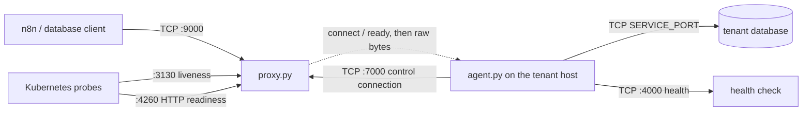
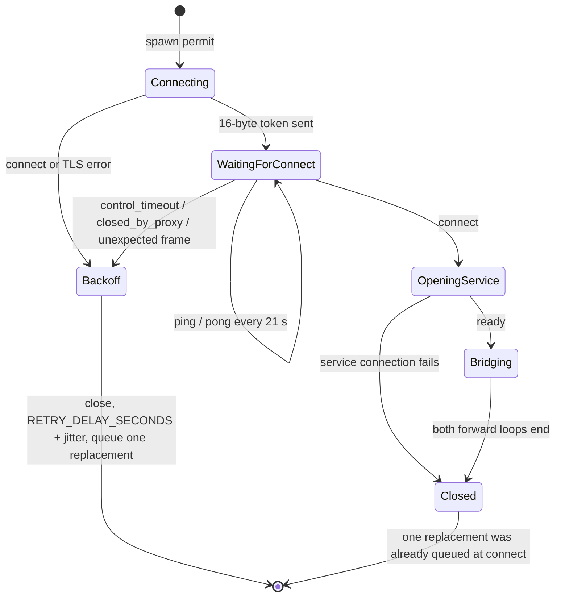

# Architecture

DBridge carries database traffic between clients that cannot route to a tenant host and the
database service that host runs. Two standalone asyncio processes do the work: `proxy.py`, which
clients reach and which holds a pool of agent connections, and `agent.py`, which runs on the
tenant host and dials out to the proxy. Neither process parses the database protocol; bytes are
forwarded unchanged. Decisions that outlive an issue live in [`adrs/`](../adrs/); the liveness
and idle-timeout policy is [ADR 0001](../adrs/0001-agent-connection-liveness.md).

## Context

`proxy.py` listens on four ports: agents (`:7000`), clients (`:9000`), liveness (`:3130`) and
readiness (`:4260`). `agent.py` holds one control connection per concurrency slot, treats silence
from the proxy as a lost connection after `CONTROL_IDLE_TIMEOUT_SECONDS`, answers the proxy's
keepalive, and opens a local service connection when it is assigned a client. The pool is
memory-only: a new proxy process starts empty and waits for agents to register.

Non-goals: authenticating agents, parsing or rewriting SQL, persisting state, any user interface.

## Modules

| Module | Responsibility | Location | Depends on |
|---|---|---|---|
| Proxy process | Four listeners, agent registration, keepalive, pool, assignment, bounded `ready` wait, byte forwarding, HTTP readiness, optional TLS | `proxy.py` | Python stdlib only |
| Agent process | Outbound control connections, control-frame deadline, OS keepalive, keepalive replies, service dial, byte forwarding, local health port | `agent.py` | Python stdlib only, the tenant service |
| Regression tests | Pool lifecycle (`AgentPoolLifecycleTest`), readiness `200`/`503`, `ready` timeout and stale `pong`, short handshake, pool report (`test_proxy.py`); control timeout, control frames and replacement accounting, service failure, idle-timeout-off (`test_agent.py`) | `test_proxy.py`, `test_agent.py` | `proxy.py`, `agent.py` |
| Proxy image | `python:3.14-alpine`, one file, four exposed ports | `Dockerfile.proxy` | — |
| Agent image | `python:3.14-alpine`, one file, health port | `Dockerfile.agent` | — |
| Agent executable | PyInstaller one-file console build `agent.exe`, attached to a tag's GitHub Release | `.github/workflows/build-pyinstaller-agent.yml`; `dbridge_agent.spec` is the local equivalent, not used by CI | — |
| Local fixtures | Four database containers for manual testing; DBridge itself is not in the compose file | `docker-compose.yml` | — |

The two scripts are standalone: `format_peer`, `writer_peer`, `parse`, `parse_bool` and `forward`
exist in both files with the same shape, and there is no shared package. `agent.py` never imports
`proxy.py` or the reverse.

## Runtime model

- One asyncio event loop per process; one task per accepted or opened connection. There are no
  threads despite the `MIN_THREADS` / `--min-threads` name — it sizes a queue of agent tasks.
- The pool is `proxy.Context`, a module-level singleton: `agents: list[Agent]` plus an
  `asyncio.Lock`. `Context.length()` reads it, `add_agent()` appends, `pop_agent()` takes from the
  front (FIFO), `clean_zombies()` sweeps it and `report_pool()` logs its size on an interval.
- Each `Agent` owns its token (`uuid.UUID`), the stream pair, `ping_pong_interval` and at most one
  keepalive task. `pop_agent()` stops that task before handing the connection to a client.
- The agent's concurrency is an `asyncio.Queue` of spawn permits consumed by `spawn_agents`. `main()`
  seeds `MIN_THREADS` permits; each permit creates one `run_agent` task, which is one control
  connection.
- An agent connection serves at most one bridge. When the proxy sends `connect`, the agent queues
  exactly one replacement connection before it opens the service, so a bridge does not reduce the
  idle count. The same `replacement_queued` flag covers every other exit from `run_agent`, so a
  failed handshake cannot queue a second one.
- Socket teardown goes through `close_writer()`, which closes the writer and waits at most 5 s for
  `wait_closed()`. Both processes carry it, so a dead peer cannot wedge the reconnect or shutdown
  path.

## Wire protocol

All messages are unframed byte strings on the control connection.

| Step | Direction | Bytes | Meaning |
|---|---|---|---|
| Token | agent → proxy | 16 | `uuid.UUID.bytes`, written raw; the proxy reads exactly 16 bytes and labels the connection `agent=<uuid>` |
| `ping` | proxy → agent | `ping` (4) | Keepalive; the first goes out at registration, then every `PING_PONG_INTERVAL_SECONDS` |
| `pong` | agent → proxy | `pong` (4) | Expected within a hard-coded 5 s |
| `connect` | proxy → agent | `connect` (7) | Assignment: promote this connection to a bridge |
| `ready` | agent → proxy | `ready` (5) | The agent has connected to the local service |
| data | both | raw | Forwarded unchanged, 4096 bytes per read on each side |

Notes that matter when changing either side:

- The proxy reads the token with `reader.readexactly(16)` inside a 10 s bound. A short read logs
  `handshake_failed reason=short_token bytes=N` at WARNING; a timeout or reset logs
  `handshake_failed reason=handshake_error`. Both close the connection; no exception escapes the
  connection handler.
- The agent reads the next message with `read_control_frame()`: it reads exactly 4 bytes, returns
  them when they are `ping`, and reads 3 more bytes only when the prefix is `conn`. A buffered
  `ping` followed by `connect` is therefore read as two frames, and a fragmented `connect` still
  arrives whole. Any other 4 bytes are returned as-is and handled as a handshake failure.
- `read_control_frame()` applies one deadline to the whole frame (`CONTROL_IDLE_TIMEOUT_SECONDS`);
  `await_ready()` on the proxy applies one deadline to the whole wait for `ready`
  (`READY_TIMEOUT_SECONDS`). No control-phase read is unbounded.
- The token is an identifier, not a credential: the proxy accepts any 16 bytes that parse as a
  UUID. The `ALLOWED_AGENTS` / `ALLOWED_CLIENTS` peer-IP allowlists (default `*`) are the only
  admission check.
- `ping`/`pong` exists only while the connection sits in the pool. `pop_agent()` stops it, so the
  bridge phase has no keepalive at the application level. A `pong` that was already in flight can
  still be buffered when `connect` is written; `await_ready()` skips it.
- The keepalive is driven by the proxy only; the agent never initiates one.

## Data flows

1. **Registration.** The agent opens TCP to `PROXY_HOST:PROXY_PORT` (TLS when `USE_SSL` is set,
   verified against `SSL_CERT` if given), logs `state=connected`, then writes its 16-byte token.
   The proxy's `handle_agent` checks the peer IP against `ALLOWED_AGENTS`; `Context.add_agent`
   reads exactly 16 bytes within 10 s, creates the `Agent`, starts the keepalive task and appends
   it to the pool. It logs `state=registered peer=...` and then `pool_size=N` at INFO. A short
   handshake is logged at WARNING as `handshake_failed reason=short_token bytes=N` (or
   `reason=handshake_error` for a stall/reset) and closed without registering anything.
2. **Keepalive.** Per agent, the proxy writes `ping` as soon as the keepalive task starts, waits at
   most 5 s for `pong` (`reader.read(4)`), then sleeps `PING_PONG_INTERVAL_SECONDS` (21 s by
   default) and repeats. A mismatch, timeout or socket error logs
   `ping_loop_failed closing_connection` and closes the connection.
3. **Client connect and assignment.** The client arrives on `:9000`, the peer IP is checked against
   `ALLOWED_CLIENTS`, and `handle_client` tries `Context.pop_agent()` up to
   `WAIT_AGENT_MAX_TRIES` times with `WAIT_AGENT_RETRY_INTERVAL` between attempts (10 × 0.7 s,
   ≈ 7 s). `pop_agent` skips entries whose reader is at EOF or whose writer is closing. When the
   pool stays empty the client is closed and `no_agent_available` is logged; nothing is sent to it.
4. **Handshake.** The proxy writes `connect` on the assigned connection and calls
   `await_ready(agent.reader, READY_TIMEOUT_SECONDS)`. `await_ready` reads 4-byte frames, discards
   a stale `pong` left over from a keepalive that was in flight when the task was stopped, and
   accepts only `ready`. On expiry it logs `bridge_aborted ... reason=agent_not_ready_timeout`,
   on EOF/reset `reason=agent_not_ready_closed`, and on any other reply
   `reason=agent_not_ready`; in every case it closes the client and the agent connection with
   bounded waits. The assigned connection is not returned to the pool; other
   entries are untouched, and the agent already queued the replacement for that slot when it
   received `connect`.
5. **Bridge.** `handle_client` gathers two `proxy.forward()` loops — `client->agent` (client reader
   to agent writer) and `agent->client` (agent reader to client writer) — with the proxy's
   `FORWARD_IDLE_TIMEOUT_SECONDS` (0, no cutoff, by default). The agent, after sending `ready`,
   gathers `proxy->service` (proxy reader to service writer) and `service->proxy` (service reader
   to proxy writer) with its own `FORWARD_IDLE_TIMEOUT_SECONDS`. Each loop reads up to 4096 bytes,
   writes and drains; when one direction ends it closes its destination, which ends the other.
   Both sides log start, duration and per-direction byte counts.
6. **Refill and reconnect.** `queue_replacement()` sets `replacement_queued` and puts one permit on
   the spawn queue, so each `run_agent` queues at most one replacement however it ends;
   `spawn_agents` starts a new `run_agent` with a fresh UUID for each permit. A connect or TLS
   error, a failed handshake, a control timeout, an EOF or a reset all end in `finally`, which
   closes the failed socket, sleeps `RETRY_DELAY_SECONDS` plus `random.uniform(0, 0.5)` seconds
   and only then queues the one replacement. A service-dial failure returns without a further
   delay because its replacement was already queued when `connect` arrived. Closing before the
   delay and queueing after it is what keeps repeated failures from accumulating open
   connections.

## Connection lifecycle and reconnection

The agent applies `CONTROL_IDLE_TIMEOUT_SECONDS` (45 s by default) to the read that waits for the
next `ping`. When the proxy is replaced and the socket goes silently half-open — no FIN and no RST
reaches the host — the read expires and the agent logs
`state=control_timeout idle_seconds=...` at WARNING. An EOF logs `state=closed_by_proxy`; a
reset surfaces as `connection_error`. Every one of those paths closes the failed socket in
`finally`, waits `RETRY_DELAY_SECONDS` plus 0–0.5 s of jitter, and then queues exactly one
replacement, so a flapping proxy cannot multiply connections. As a kernel-level backstop,
`enable_keepalive()`
sets `SO_KEEPALIVE` and tunes it on a best-effort basis (Linux `TCP_KEEPIDLE=30`,
`TCP_KEEPINTVL=10`, `TCP_KEEPCNT=3`; Windows `SIO_KEEPALIVE_VALS` idle 30 s, interval 10 s). A
failed tuning is logged at DEBUG and never blocks the connection; the application deadline is the
guarantee.

## Failure behaviour

- **No agent available.** The client waits ≈ 7 s and is closed without a reply. The proxy logs
  `no_agent_available`; the client sees the connection end.
- **Agent never sends `ready`.** The proxy waits `READY_TIMEOUT_SECONDS` (30 s) in `await_ready`,
  skipping a stale `pong`. On expiry it logs
  `bridge_aborted ... reason=agent_not_ready_timeout`; an EOF or reset logs
  `reason=agent_not_ready_closed`, and a wrong reply `reason=agent_not_ready`. In every case it
  closes the client and the agent connection with bounded waits and leaves the rest of the pool
  untouched. The assigned connection was already removed from the pool and is not put back; the
  agent queued a replacement for the slot when it received `connect`.
- **Service connection fails.** `asyncio.open_connection` raises `OSError`; the agent logs
  `service_connection_failed service=host:port exception=<repr>` with the real exception, returns
  without sending `ready`, and `finally` closes the control connection. The replacement was
  already queued at assignment, so no second one is queued.
- **Keepalive fails.** The proxy closes the socket. The agent's blocked control read gets EOF
  (`state=closed_by_proxy`), a reset (`connection_error`) or the deadline (`state=control_timeout`).
  In every case the failed socket is closed, the jittered delay elapses, and then one
  replacement is queued.
- **Short handshake.** A peer that sends fewer than 16 bytes is logged as
  `handshake_failed reason=short_token bytes=N`; one that stalls for 10 s or resets is logged as
  `handshake_failed reason=handshake_error`. Both are closed; nothing is registered and no
  exception escapes the connection handler.
- **Proxy restarts.** Every control connection ends at once; agents take the reconnect path. A
  proxy that disappears without closing the sockets is detected by the 45 s deadline instead.
  The new proxy starts with an empty pool and fills it only through registrations — there is no
  handover of tokens or sessions.
- **Client disconnects mid-bridge.** The client→agent loop sees EOF, closes the agent writer, and
  the agent's forwarding ends. The agent-side replacement connection was already queued.

## Timeouts

| Timer | Setting | Current value | Where |
|---|---|---|---|
| Keepalive interval | `PING_PONG_INTERVAL_SECONDS` | 21 s, validated `0 < x < 30` | `Agent.run_ping_pong` |
| Pong deadline | hard-coded | 5 s | `Agent.run_ping_pong` (`reader.read(4)`) |
| Agent control read | `CONTROL_IDLE_TIMEOUT_SECONDS` | 45 s, validated `0 < x ≤ 300` | `run_agent` (`read_control_frame`) |
| Wait for `ready` | `READY_TIMEOUT_SECONDS` | 30 s, validated `0 < x ≤ 300` | `handle_client` (`await_ready`) |
| Token handshake read | hard-coded | 10 s | `Context.add_agent` (`readexactly(16)`) |
| Socket close wait | hard-coded | 5 s | `close_writer` in both files |
| Readiness request read | hard-coded | 2 s | `handle_readiness` |
| Assignment wait | `WAIT_AGENT_MAX_TRIES` × `WAIT_AGENT_RETRY_INTERVAL` | 10 × 0.7 s ≈ 7 s | `handle_client` |
| Zombie sweep | `ZOMBIES_CLEAN_INTERVAL` | 0 (off) in code; 90 s in `Dockerfile.proxy` | `Context.clean_zombies` |
| Pool report | `POOL_REPORT_INTERVAL_SECONDS` | 60 s, `0` disables | `Context.report_pool` |
| Reconnect delay | `RETRY_DELAY_SECONDS` + jitter | 1.0 s + `random.uniform(0, 0.5)`, validated `0 < x ≤ 300` | `run_agent` (`reconnect_delay`) |
| OS keepalive | hard-coded | Linux idle 30 s / interval 10 s / 3 probes; Windows idle 30 s / interval 10 s | `enable_keepalive` |
| Data idle cutoff, proxy | `FORWARD_IDLE_TIMEOUT_SECONDS` | 0 (no cutoff) | `proxy.forward` |
| Data idle cutoff, agent | `FORWARD_IDLE_TIMEOUT_SECONDS` | 0 (no cutoff) | `agent.forward` |

Neither Dockerfile sets `FORWARD_IDLE_TIMEOUT_SECONDS`, `READY_TIMEOUT_SECONDS` or
`POOL_REPORT_INTERVAL_SECONDS`, so the code defaults apply inside the images too. A data cutoff
closes the destination of that direction, which ends the bridge; the bytes already forwarded are
not rolled back. The reconnect delay applies to every failure before the bridge; a service-dial
failure is the exception because its replacement was already queued at `connect`. Every other
environment variable and flag is in [configuration.md](configuration.md).

## Persistence and state

None. There is no database, no file and no schema. The only state is the in-memory pool and the
per-connection tasks; a proxy restart loses all registrations and a client bridge never survives
it. The tenant side keeps no state either: each reconnect is a new connection with a new token.

## Integrations

| Integration | Direction | Protocol | Purpose | Failure mode |
|---|---|---|---|---|
| Database clients (n8n in production) | in | raw TCP `:9000`, optional TLS | Carry database traffic | Closed after ≈ 7 s when the pool is empty |
| Tenant database service | out (from the agent) | raw TCP `SERVICE_PORT` | Serve the forwarded traffic | Agent logs, closes the control connection, retries |
| Kubernetes probes | in | TCP `:3130`, HTTP `:4260` | Liveness, readiness | Liveness answers on connect; readiness answers `503` when the pool is empty |
| Health check | in | TCP `localhost:4000` | Agent process liveness | Fixed greeting, no pool or bridge state |
| GitHub Actions | out (CI) | docker push to GHCR, cosign, release upload | Publish images and `agent.exe` | Workflow fails; no runtime impact |

## Probes and health endpoints

| Endpoint | Process | Behaviour today |
|---|---|---|
| `:3130` liveness | proxy | Accepts, writes `🚀 alive and forwarding packets like a champ!`, closes. Plain TCP, no HTTP, no pool check |
| `:4260` readiness | proxy | Reads the HTTP request head for up to 2 s (a client that sends nothing is tolerated), then answers `HTTP/1.1 200 OK` with body `ready` when the pool is non-empty, or `HTTP/1.1 503 Service Unavailable` with body `not ready` when it is empty. `Content-Type: text/plain; charset=utf-8`, `Content-Length`, `Connection: close` |
| `localhost:4000` health | agent | Accepts, writes `💅 slaying and thriving, PERIOD.`, closes. Bound to localhost only |

Readiness carries a real status code, so an `httpGet` probe sees `503` on an empty pool. The old
`tcpSocket` probe keeps passing: the TCP connect still succeeds, and the handler simply spends its
2 s request-read window before answering.

## Observability

- Both processes call `logging.basicConfig(level=..., format="%(asctime)s %(levelname)s %(message)s")`
  and set `logging.Formatter.converter = time.gmtime`, so every line starts with a UTC timestamp
  and its level name. Severity is visible in the line, not only in the `LOG_LEVEL` filter.
- Log lines are key/value pairs designed for `grep` and log search. The recurring keys are
  `agent=<uuid>`, `agent_token=`, `client=`, `client_peer=`, `agent_peer=`, `state=`, `pool_size=`,
  `remaining_pool=`, `direction=`, `duration=`, `bytes_client_to_agent=`,
  `bytes_agent_to_client=`, `bytes_proxy_to_service=`, `bytes_service_to_proxy=`, `idle_seconds=`,
  `service=`, `exception=`, `reason=`.
- Pool size is logged at INFO on registration, assignment and discard:
  `agent=<token> pool_size=N` after registration, `state=assigned remaining_pool=N` after
  assignment, `state=zombie_discarded pool_size=N` when a dead entry is discarded.
  `Context.report_pool()` adds a `pool_size=N` line every `POOL_REPORT_INTERVAL_SECONDS` (60 s by
  default; `0` disables the periodic line, not the change lines). The sweep logs
  `state=zombie_detected` and `cleaned_zombie_agents=N pool_size=N`.
- Reconnect and handshake failures have their own lines: `state=control_timeout
  idle_seconds=...` and `state=closed_by_proxy` on the agent, `service_connection_failed ...
  exception=...` on a failed service dial, `handshake_failed reason=short_token bytes=N` or
  `reason=handshake_error` on an agent handshake, and `bridge_aborted ... reason=` with
  `agent_not_ready_timeout`, `agent_not_ready_closed` or `agent_not_ready` when the wait for
  `ready` ends. `keepalive_not_tuned` exists only at DEBUG.
- There are no metrics and no traces. The probes are the only machine-readable signal; readiness
  is the alerting hook for an empty pool.

## Security boundaries

- The agent port is unauthenticated. Any peer admitted by `ALLOWED_AGENTS` that writes 16 bytes is
  registered; nothing binds a token to a tenant, host or secret.
- `ALLOWED_AGENTS` and `ALLOWED_CLIENTS` compare the peer IP string, not a hostname, and default to
  `*`.
- TLS is optional and applies to the agent and client listeners together, using one server
  certificate and key (`SSL_CERT`, `SSL_KEY`); the agent verifies the proxy against `SSL_CERT` when
  `USE_SSL` is set. No client certificates, so the agent port stays open to any admitted peer.
- Liveness is a plain TCP greeting; readiness is plain HTTP and exposes only a boolean
  (`200`/`503`). Neither is encrypted or authenticated.
- The proxy forwards bytes without inspection: database authentication happens end to end between
  client and service and DBridge never sees a credential it can interpret.

## Deployment topology

- `.github/workflows/build-publish-proxy.yml` and `build-publish-agent.yml` build
  `Dockerfile.proxy` and `Dockerfile.agent` into `ghcr.io/<owner>/<repo>-proxy` and
  `ghcr.io/<owner>/<repo>-agent` on pushes to `main`, semver tags, the daily 05:00 UTC schedule and
  manual dispatch; pull requests build without pushing. Images are signed with cosign on publish.
- `.github/workflows/build-pyinstaller-agent.yml` builds `agent.exe` on `windows-latest` with
  Python 3.13 and attaches it to the GitHub Release for a `v*.*.*` tag.
- `docker-compose.yml` starts only MySQL, PostgreSQL, MariaDB and MSSQL for local testing. It does
  not run the proxy or the agent.
- A tenant is served by one proxy deployment and the agents on its hosts. No Kubernetes manifests,
  Helm chart or Argo configuration are in this tree; the proxy is deployed from outside this
  repository.

## ADR index

| ADR | Title | Status |
|---|---|---|
| [0001](../adrs/0001-agent-connection-liveness.md) | Detect a dead agent control connection with an application deadline | accepted |

The template is [`adrs/0000-template.md`](../adrs/0000-template.md). A changed decision is a new
ADR that supersedes the old one; the old file is never edited.
